<!-- _class: capa -->

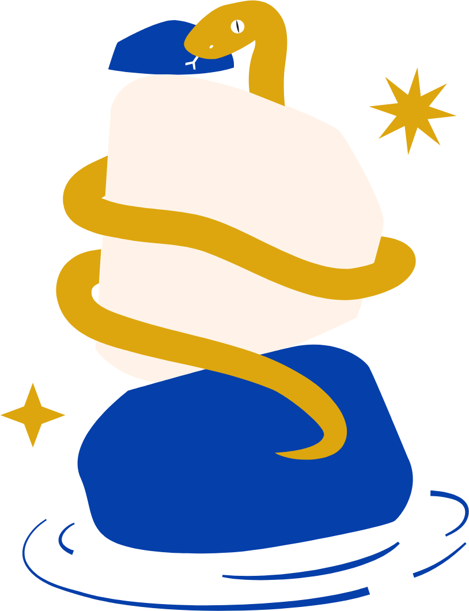

# De graça, por voluntários, **para quem chegar**

O futuro de eventos de comunidade · 100ª Python Floripa

Rodrigo Vieira

<!--
Slide de espera, enquanto a pessoa apresentadora chama a LT.
-->

---

<!-- _class: foto -->

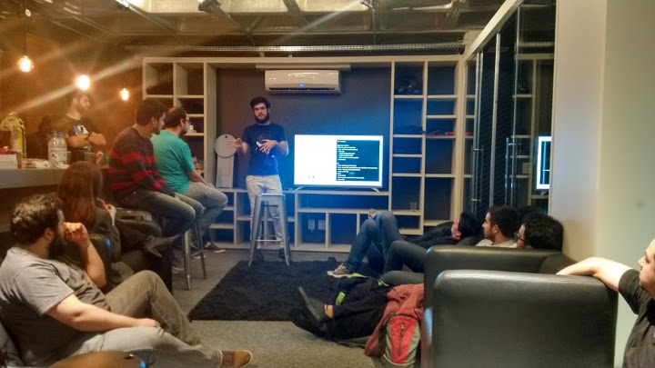

2015

Uma sala, um sofá, umas dez pessoas

<!--
Essa é a Python Floripa em 2015.
Uma sala, um sofá, uma palestra e umas dez pessoas.
-->

---

<!-- _class: foto -->

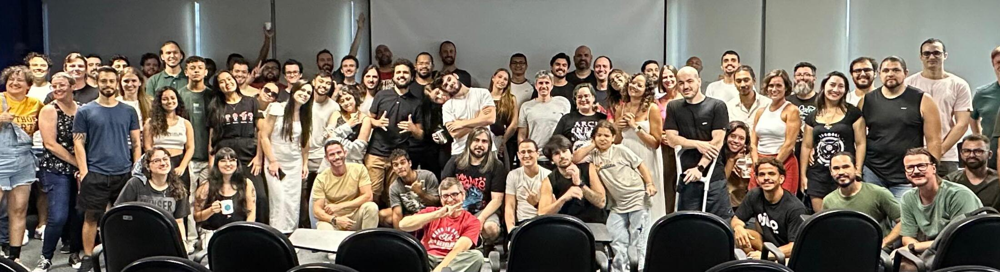

2025

A foto oficial de um sábado qualquer

<!--
Essa é a Python Floripa hoje.
-->

---

<!-- _class: numero -->

# 100

Hoje, na Python Brasil

<!--
E hoje, aqui na Python Brasil, a gente chega à edição número 100.

100 edições em 11 anos, quase sempre num sábado à tarde, começando às 13h29.
Mais de 30 lugares diferentes: empresas, universidades, coworkings, até um food truck.
Cada edição precisou de alguém para palestrar, alguém para trazer o café
e alguém para abrir a porta.

Toda Python Floripa começa com o Juramento de Turing.
A primeira promessa é: "colocar pessoas acima de tecnologias".
Essa lightning talk é sobre essas pessoas.
-->

---

<!-- _class: frase -->

# De graça. Por voluntários. **Para quem chegar.**

<!--
RASCUNHO, texto a fechar.
- Toda edição é gratuita e quem organiza é voluntário.
- Ninguém precisa de convite, cargo ou experiência para entrar.
-->

---

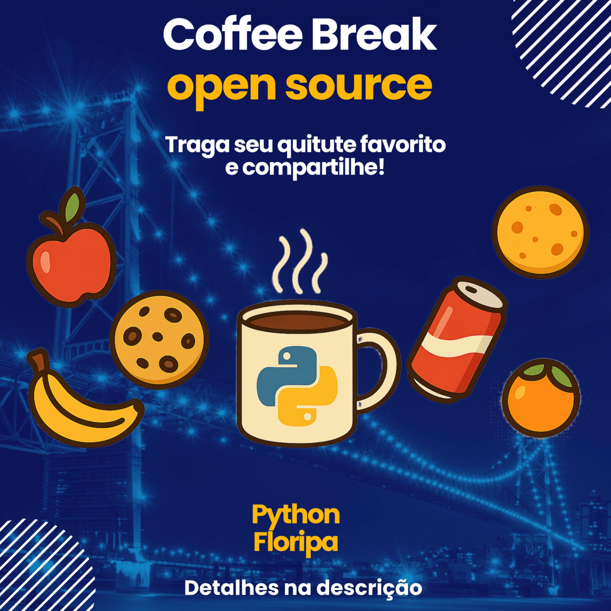
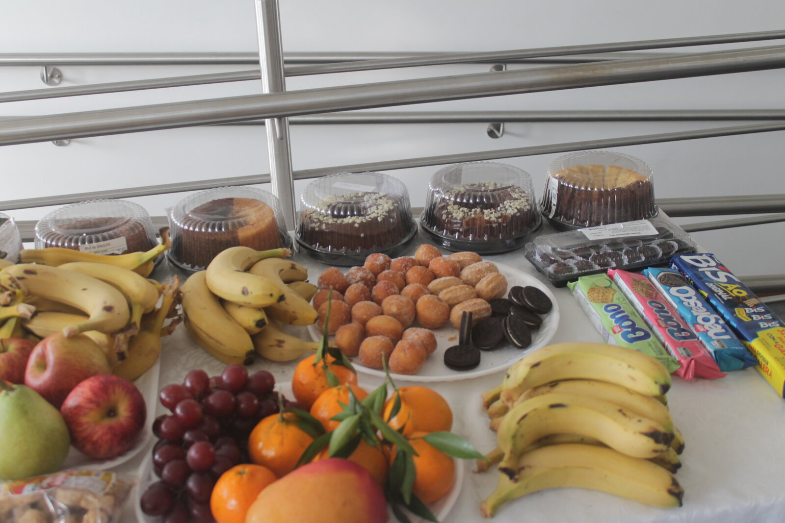

<!--
RASCUNHO, texto a fechar.
- Quando não tem patrocínio para o café, tem coffee break open source: cada pessoa traz alguma coisa.
- Do texto de divulgação: "muitos commits pequenos resultam em algo grandioso".
- A organização passa o café; levar comida é voluntário, e quem não puder levar vem mesmo assim.
- Foto: a mesa da 88ª, julho de 2025.
-->

---

<!-- _class: foto -->

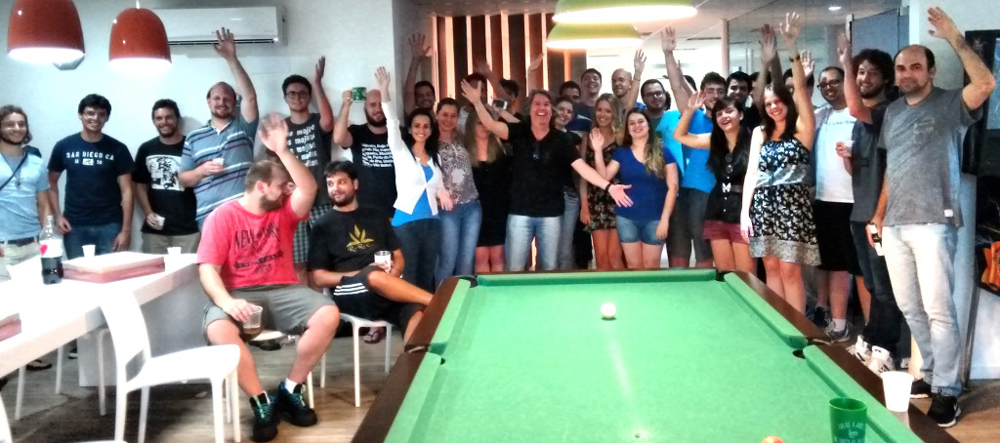

O começo

Um punhado de gente marcando o próximo encontro

<!--
Tudo começou com um punhado de gente: o JJ, o Elias, o Felipe.
Uma sala, uma palestra e a vontade de marcar o próximo encontro.
Com poucos meses de vida, essa turma já sonhava em trazer a Python Brasil para Floripa.
-->

---

<!-- _class: foto -->

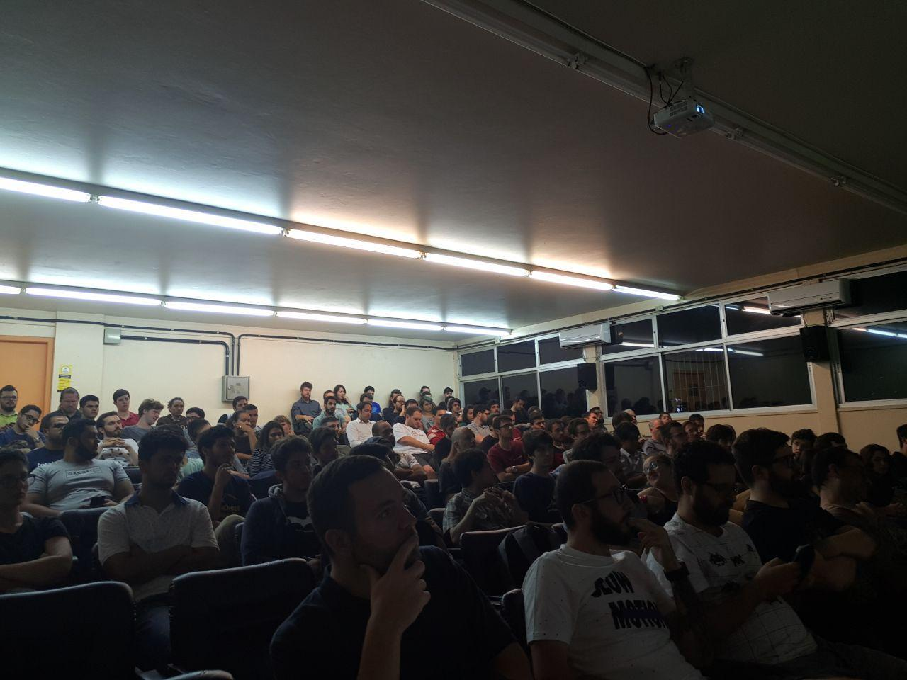

Crescendo

Auditórios cheios, a comunidade saindo da ilha

<!--
Depois o Mário Sérgio e a Talita pegaram o bastão.
A comunidade cresceu, encheu auditórios e saiu da ilha.
Mais tarde o Calixto se juntou à Talita na organização.
E aí veio 2020.
-->

---

<!-- _class: online -->

2020 e 2021

# A Python Floripa foi para a **casa de cada um**

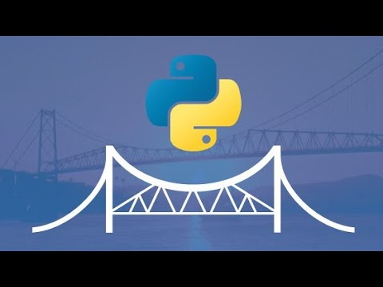<b>54º Python Floripa de Natal on-line</b>▷ 152 visualizações

<b>53º Python Floripa on-line</b>▷ 205 visualizações

<b>52º Python Floripa on-line</b>▷ 166 visualizações

<b>51º Python Floripa on-line</b>▷ 152 visualizações

<b>50º Python Floripa on-line</b>▷ 1,1 mil visualizações

<b>49º Python Floripa on-line (5 anos!!!)</b>▷ 518 visualizações

<!--
RASCUNHO, texto a fechar.
- A pandemia cancelou o encontro de março. O mais fácil seria parar.
- Um mês depois a Python Floripa estava no YouTube, e ficou lá um ano e meio, todo mês.
- Comemorou 5 anos online. O Calixto abria a transmissão de casa, todo mês.
- Teve mês com meia dúzia de pessoas assistindo. Tudo bem: o encontro aconteceu.
- Quando deu para voltar, voltou com a transmissão ligada, para quem não podia estar na sala.
-->

---

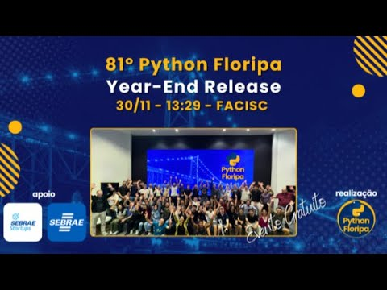
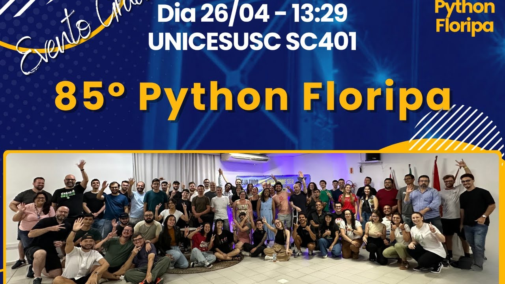
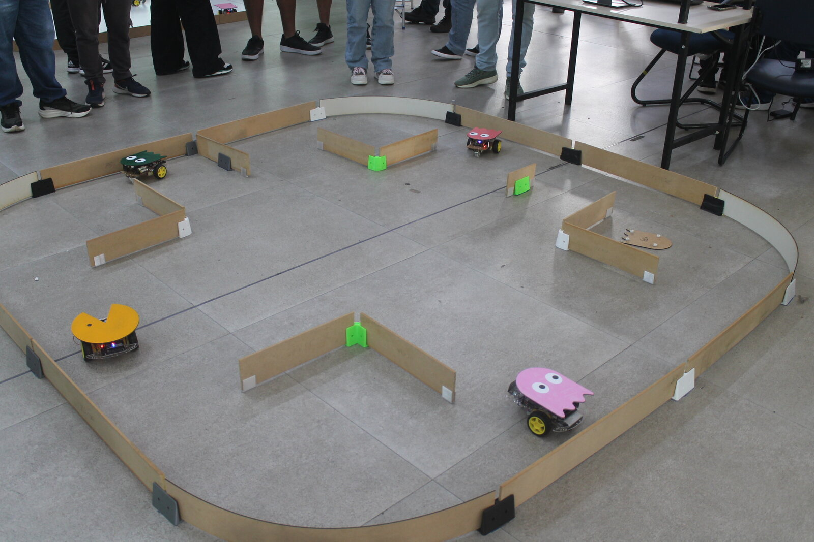
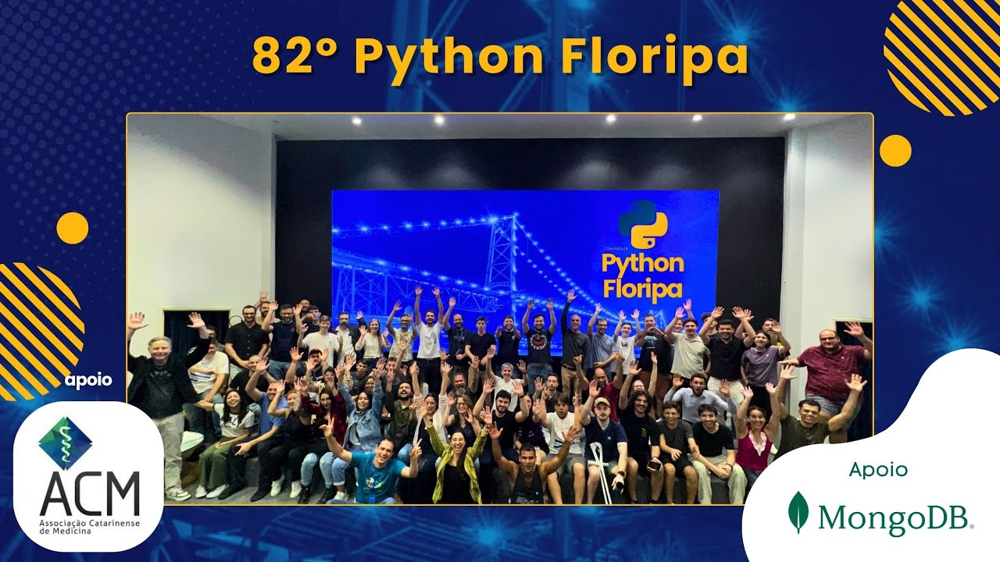

<!--
RASCUNHO, texto a fechar.
- Sobrevivemos, e aqui estamos: encontro todo mês, com 50 a 100 pessoas na sala.
- Hoje quem mantém esse ritmo é o Jardel.
- Além dos encontros: hackathons, oficinas e robôs (o Pac-Man e o fantasma são do hackathon).
-->

---

<!-- _class: foto -->

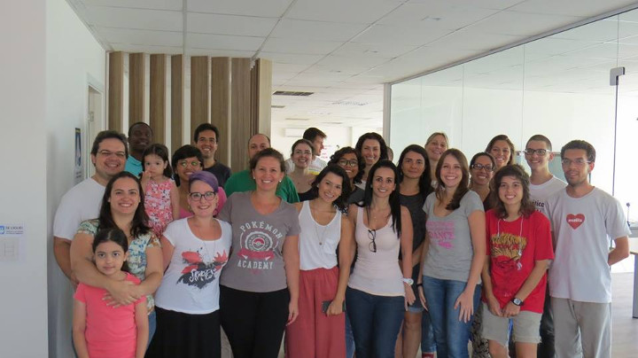

PyLadies Floripa

Caminhando junto há 10 anos

<!--
RASCUNHO, texto a fechar.
- A PyLadies Floripa caminha junto desde o começo e fez 10 anos.
- As duas comunidades fazem encontros juntas.
-->

---

<!-- _class: frase -->

# Fique de pé se você já...

* foi a uma Python Floripa
* deu uma palestra ou uma lightning talk
* organizou, serviu café, carregou cadeira ou achou um lugar

<!--
RASCUNHO, texto a fechar.
- Pedir que levantem em camadas. Quase todo mundo vai estar de pé no fim.
-->

---

<!-- _class: obrigado -->

# Obrigado

*  **JJ** criou a casa
* 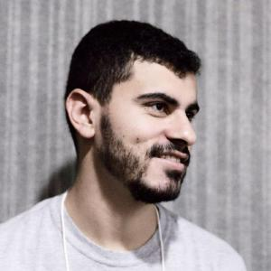 **Mário Sérgio** ajudou a crescer
* 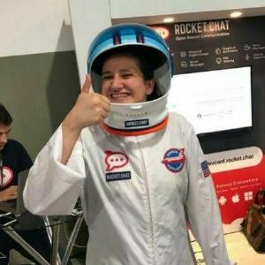 **Talita Rossari** coordena esta Python Brasil
* 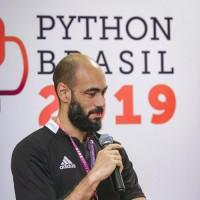 **Rafael Calixto** segurou a pandemia
* 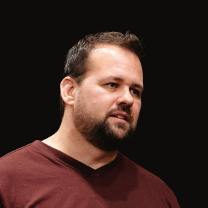 **Jardel Godinho** mantém a porta aberta

<!--
RASCUNHO, texto a fechar.
- Um nome por clique, com aplausos.
- Na Talita: a comunidade que um dia quis trazer a Python Brasil hoje ajuda a organizá-la, e a 100ª acontece dentro dela.
-->

---

<!-- _class: fim -->

# O futuro de eventos **de comunidade**

De graça, por voluntários, para quem chegar

Pessoas &gt; Tecnologias

<!--
RASCUNHO, texto a fechar.
- Repetir com a plateia a primeira promessa do juramento.
- Passar a palavra para o painel.
-->
