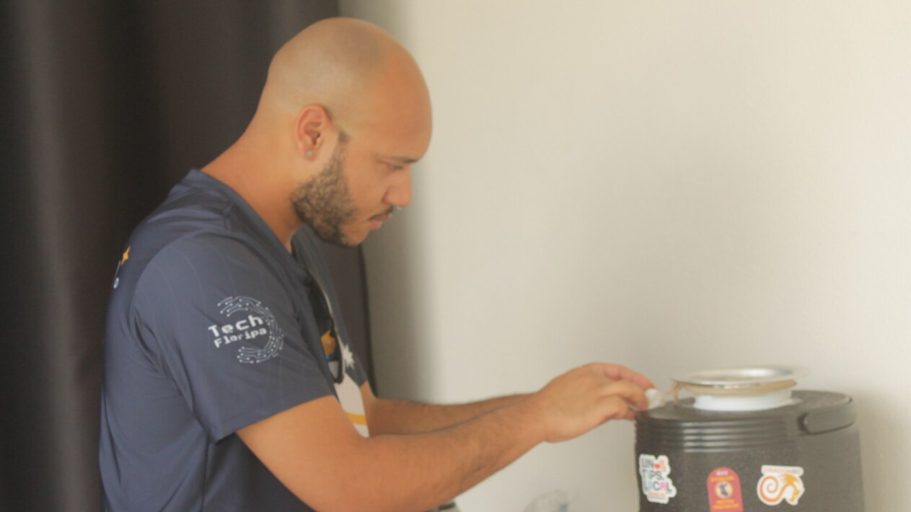
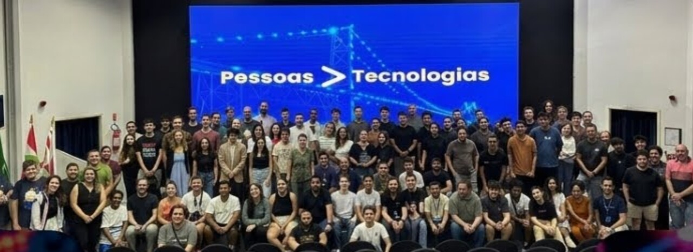
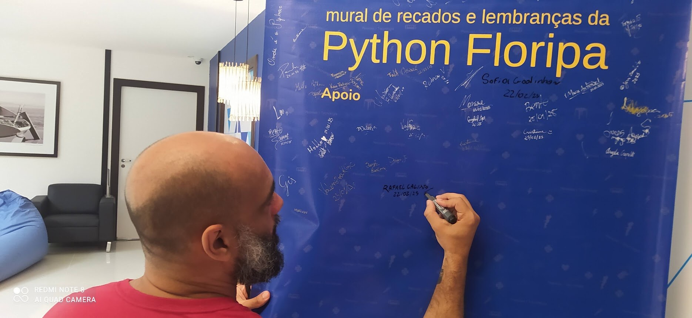
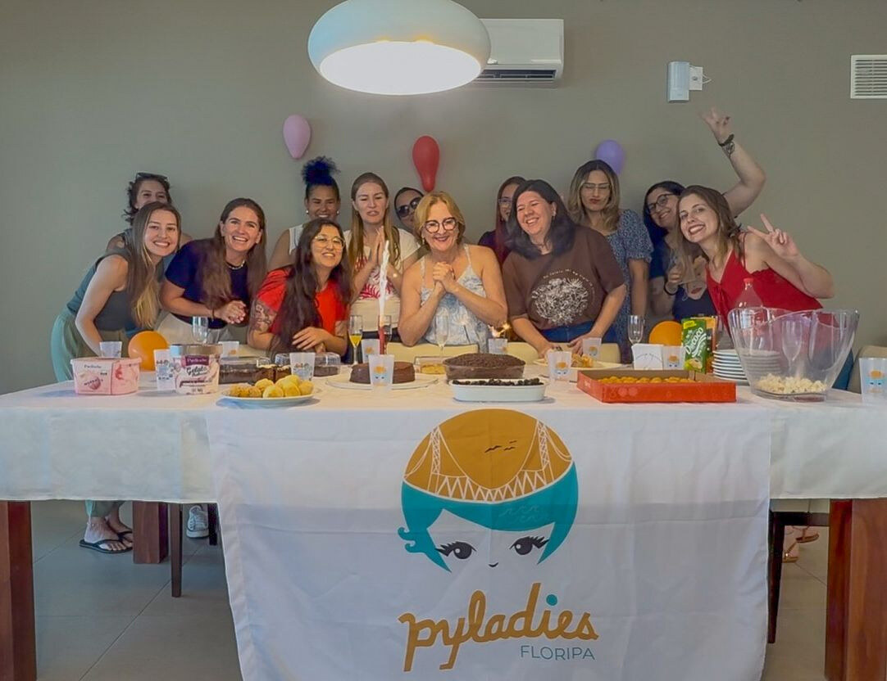
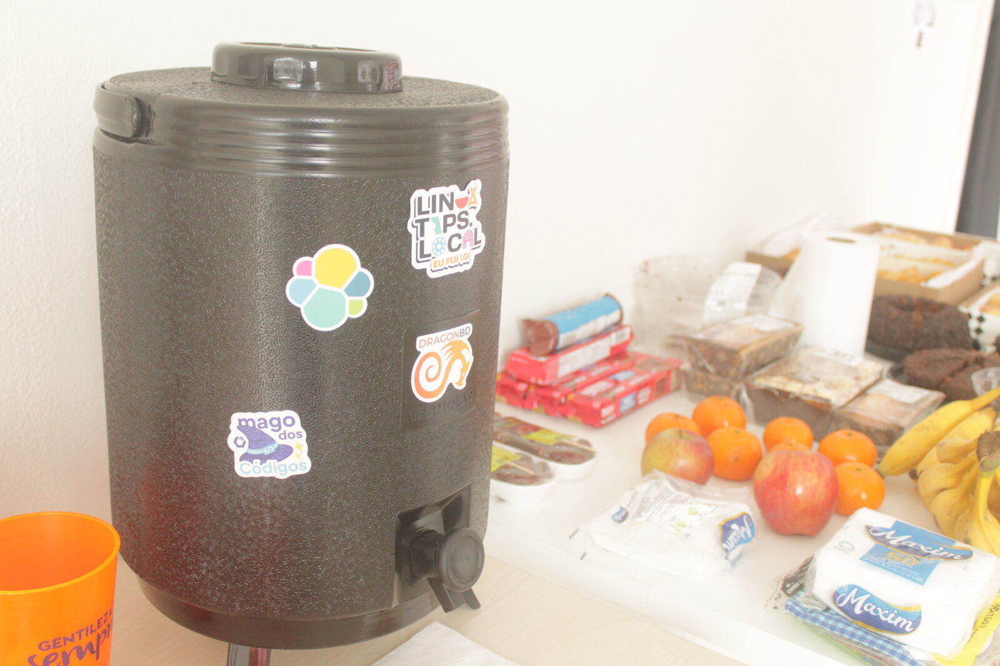

<!-- _class: capa -->

# De graça, por voluntários, **para quem chegar**

O futuro de eventos de comunidade · 100ª Python Floripa

Rodrigo Vieira

<!--
Slide de espera, enquanto a pessoa apresentadora chama a abertura.
-->

---

<!-- _class: numero -->

# 100

Hoje, na Python Brasil

<!--
Hoje a Python Floripa chega à edição número 100.
-->

---

<!-- _class: foto -->

Toda edição

Alguém passa o café

<!--
Esse é o Wallacy, passando o café na garrafa que a comunidade comprou.
Em toda edição, alguém passa o café.
E essa história começa com um café.
-->

---

<!-- _class: foto -->

2015

Umas dez pessoas num sofá. Alguém trouxe o café.

<!--
Em 2015, umas dez pessoas se juntaram num sofá para ver uma palestra de Python.
Alguém trouxe o café.
O JJ já tinha criado o GitHub da comunidade. O Elias deu a primeira palestra. O Felipe fez o site.
-->

---

<!-- _class: foto -->

Todo mês

Alguém achava uma sala. Alguém palestrava pela primeira vez. Alguém passava o café.

<!--
E aí virou rotina.
Todo mês, alguém achava uma sala.
Alguém palestrava pela primeira vez.
Alguém passava o café.
-->

---

<!-- _class: foto -->

Mais cadeiras

Mais café

<!--
Com o Mário Sérgio e a Talita, a roda precisou de mais cadeiras. E de mais café.
A comunidade encheu auditórios e saiu da ilha.
Depois o Calixto se juntou à Talita.
-->

---

<!-- _class: frase -->

# Em março de 2020, **a sala fechou.**

<!--
Até que, em março de 2020, a sala fechou.
O mais fácil seria parar.
-->

---

<!-- _class: online -->

2020 e 2021

# Cada um passou o próprio café **em casa**

<b>54º Python Floripa de Natal on-line</b>▷ 152 visualizações

<b>53º Python Floripa on-line</b>▷ 205 visualizações

<b>52º Python Floripa on-line</b>▷ 166 visualizações

<b>51º Python Floripa on-line</b>▷ 152 visualizações

<b>50º Python Floripa on-line</b>▷ 1,1 mil visualizações

<b>49º Python Floripa on-line (5 anos!!!)</b>▷ 518 visualizações

<!--
Em vez de parar, cada um passou o próprio café em casa, e a live abriu no sábado.
Todo mês, por um ano e meio. O Calixto abria a transmissão.
Teve mês com meia dúzia de pessoas assistindo.
A live abriu do mesmo jeito.
A gente até comemorou 5 anos assim.
-->

---

<!-- _class: foto -->

Voltamos

50 a 100 pessoas, todo mês

<!--
Quando deu, a gente voltou.
Hoje são 50 a 100 pessoas por mês.
A tela atrás diz o que a gente promete no começo de cada encontro: pessoas acima de tecnologias.
-->

---

<!-- _class: foto -->

Passando o bastão

O Calixto assina o mural antes de se mudar para Portugal

<!--
No último encontro antes de se mudar para Portugal, o Calixto assinou o mural da comunidade.
Ele passou o bastão, e o Jardel seguiu passando o café.
-->

---

<!--
E a roda não para de inventar coisa: hackathon, oficina, até robô.
O Pac-Man e o fantasma aí embaixo são de um hackathon nosso.
-->

---

<!-- _class: foto -->

PyLadies Floripa

Caminhando junto há 10 anos

<!--
E a gente nunca caminhou sozinho: a PyLadies Floripa está junto há 10 anos.
-->

---

<!-- _class: frase -->

# De graça. Por voluntários. **Para quem chegar.**

<!--
Tudo isso de graça.
Feito por voluntários.
Para quem chegar.
-->

---

<!--
E quando não tem patrocínio para o café?
Tem coffee break open source: cada pessoa traz um pouco.
Muitos commits pequenos, e a mesa fica cheia. Ao lado, a garrafa que a comunidade comprou.
-->

---

<!-- _class: frase -->

# Fique de pé se você já...

* foi a uma Python Floripa
* deu uma palestra ou uma lightning talk
* organizou, serviu café, carregou cadeira ou achou um lugar

<!--
Fique de pé se você já foi a uma Python Floripa.
Continue de pé se já deu uma palestra ou uma lightning talk.
E se já organizou, serviu café, carregou cadeira ou achou um lugar.
-->

---

<!-- _class: obrigado -->

# Quem passou o café

*  **JJ** criou a casa<em>2014 a 2017 · ~25 edições</em>
*  **Mário Sérgio** ajudou a crescer<em>2016 a 2019 · ~30 edições</em>
*  **Talita Rossari** coordena esta Python Brasil<em>2017 a hoje · ~80 edições</em>
*  **Rafael Calixto** segurou a pandemia<em>2018 a 2024 · ~45 edições</em>
*  **Jardel Godinho** mantém a porta aberta<em>2024 a hoje · ~20 edições</em>

<!--
Por 100 edições, alguém passou o café. Algumas pessoas passaram por muitos anos.
Um nome por clique, com aplausos.
Na Talita: a comunidade que um dia quis trazer a Python Brasil hoje ajuda a organizá-la.
-->

---

<!-- _class: fim -->

# Quem vai passar o café **da edição 200?**

O futuro de eventos de comunidade

Pessoas &gt; Tecnologias

<!--
Então a pergunta para o painel é:
quem vai passar o café da edição 200?
-->
